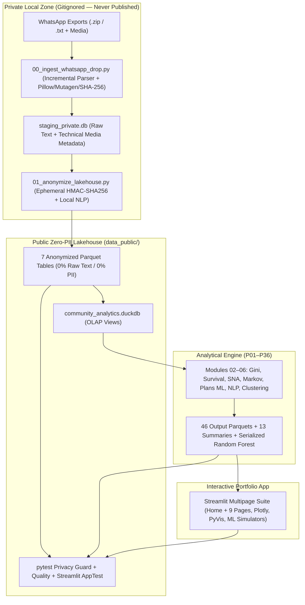

# Community Dynamics Analytics

[](https://www.python.org/)
[](https://duckdb.org/)
[](https://streamlit.io/)
[](#privacy-by-design-and-data-governance)
[](LICENSE)

End-to-end analytics, social network analysis (SNA), survival modeling, multimodal metadata extraction, and machine learning portfolio built on real-world data from an urban social community founded in Bogotá, Colombia.

The project models how strangers interact across a multi-group messaging ecosystem, form subcommunities, retain over time, and convert digital conversations into in-person plans—answering **36 structured analytical questions (`P01`–`P36`)** through a reproducible Python + DuckDB Lakehouse and a 10-page interactive Streamlit application.

---

## Executive Summary & Key Findings

Analyzed baseline snapshot (`2026-09-04` to `2026-11-11`): **20 community groups**, **398 active anonymized members**, **162,831 messages**, **3,420 lifecycle events**, **1,104 in-person plan proposals**, and **15,063 indexed media files** (stickers, photos, voice notes, videos, and documents).

| Analytical Domain | Metric / Test | Empirical Result | Business & Product Implication |
| :--- | :--- | :--- | :--- |
| **Participation Inequality (`P02`)** | Gini Coefficient / Lorenz Curve | `Gini = 0.8453` · Top 10% = `75.5%` of volume | Confirms a sharp 1–9–90 distribution; 46 members generate 80% of messages while niche subgroups foster flatter participation. |
| **Onboarding Retention (`P12`)** | Kaplan-Meier + Log-Rank Test | `59.3 days` vs. `4.9 days` median survival (`p = 1.78e-24`) | Introducing oneself in the onboarding channel is associated with a 12x longer median lifespan and 9.3x higher message volume. |
| **Network Structure (`P15`–`P19`)** | Reciprocity / Degree Assortativity | `77.7%` reciprocity · `r = -0.3439` assortativity | High-degree hubs actively engage newer/low-degree members rather than forming a closed clique; 9 *Silent Bridges* connect subgroups. |
| **Network Resilience (`P18`)** | Percolation Simulation (*Bus Factor*) | Giant component drops to `72.3%` (targeted) vs. `88.5%` (random) | Targeted removal of top 10% betweenness connectors fragments the network significantly faster than random churn. |
| **Multigroup Dynamics (`P20`)** | Pre/Post Launch Event Study | Niche/geo launch: `+250%` total · Generic chat: `-75%` core | Purpose-built geographic subgroups expand total engagement, whereas overlapping generic channels cannibalize the main group. |
| **Plan Traction & ML (`P27`–`P29`)** | Random Forest (5-fold CV) + Mann-Whitney | `ROC-AUC = 0.8375` · Pin effect `p = 1.60e-28` · Social capital `r = 0.027` | Plan traction is meritocratic (initiator centrality barely matters), while pinning a proposal raises 2h responders from `15` to `23`. |
| **Multimodal Behavior (`P34`–`P35`)** | SHA-256 Sticker Reuse / Voice Duration | `38.5%` sticker reuse (`2,318` cross-group) · Median voice note `8.3s` | Visual micro-communication travels across up to 13 groups; voice notes remain concise and do not penalize reply speed. |

---

## Architecture

The architecture enforces a strict physical boundary between private raw exports (`data_private/`, gitignored) and the anonymized analytical Lakehouse (`data_public/`, Zero-PII verified by automated tests).



---

## Coverage of the 36 Analytical Questions

| Pillar | Questions | Techniques & Statistical Methods | Streamlit Page |
| :--- | :---: | :--- | :--- |
| **1. Macro Health & Inequality** | `P01`–`P05` | DAU/WAU/MAU, Stickiness, Lorenz Curve, Gini, Net Growth, Spearman, Activation Funnel | `01_Salud_y_Desigualdad` |
| **2. Chronobiology & Rhythms** | `P06`–`P09` | 7x24 Heatmaps, Circadian Signatures, First Response Time (`LAG()`), Z-Score Bursts, ACF | `02_Cronobiologia_y_Ritmos` |
| **3. Survival & Cohorts** | `P10`–`P14` | Kaplan-Meier (`lifelines`), Weekly Cohorts, Log-Rank, Mann-Whitney U, Before/After Impact | `03_Supervivencia_y_Cohortes` |
| **4. Social Network Analysis** | `P15`–`P19` | Weighted Directed Graph (`Δt <= 180s`), Louvain (`Q`), Betweenness, Percolation, Reciprocity | `04_Grafos_Sociales_SNA` |
| **5. Multigroup & Urban Geography** | `P20`–`P24` | Share of Voice, First-Order Markov Transitions (Sankey), Jaccard Matrix, Multi-group Sweet Spot | `05_Ecosistema_y_Geografia` |
| **6. Plans Economy & ML** | `P25`–`P29` | 2h/24h Traction Windows, Pin Impact, Stratified 5-Fold Random Forest + Permutation Importance | `06_Planes_y_Mundo_Real` |
| **7. Conversational NLP & Media** | `P30`–`P35` | Local Lexical Sentiment, Burst Index, TF-IDF + NMF Topics, Media Mix, Sticker Virality, `.opus` Duration | `07_NLP_y_Cultura_Multimedia` |
| **8. Human Archetypes (Clustering)** | `P36` | Standardized 14-Feature K-Means Clustering + PCA 2D Projection & Behavioral Radar | `08_Arquetipos_de_Miembros` |

---

## Privacy-by-Design and Data Governance

Built in strict alignment with **Colombian Data Protection Law (Ley 1581 de 2012)**:

1. **Strict Scope Exclusion:** Only official community groups are processed. All 1-on-1 private chats and sensitive moderation channels are excluded at ingestion.
2. **Irreversible Identity Anonymization:** Sender identifiers are mapped using `HMAC-SHA256` with an ephemeral 256-bit in-memory salt (discarded immediately after execution) into sequential opaque IDs (`MEM_001`–`MEM_NNN`). Groups are mapped to standardized analytical archetypes (`G01_CORE_GENERAL`, `G07_GEO_NORTE`, etc.).
3. **Zero Raw Content Published:** No message text, images, voice recordings, phone numbers, emails, or real names exist anywhere in this repository. NLP signals and technical media attributes (file size, duration, dimensions, anonymized content fingerprint) are computed locally before discarding raw inputs.
4. **Automated Privacy Gate:** `tests/test_privacy_guard.py` recursively inspects every `.parquet` and `.json` file in `data_public/` via strict column blocklists and regex checks on every test run and CI workflow.

---

## Repository Structure

```text
community-dynamics-analytics/
├── app/
│   ├── Home.py                            # Executive overview & 36-question navigator
│   ├── pages/                             # 9 thematic analytical pages + interactive simulators
│   └── utils/                             # Cached data loaders, Plotly styling, dark editorial CSS
├── pipeline/
│   ├── config.py                          # Group archetypes, privacy exclusions, local lexicons
│   ├── 00_ingest_whatsapp_drop.py         # Baseline & incremental WhatsApp/media drop ingestion
│   ├── 01_anonymize_lakehouse.py          # Zero-PII anonymization, local NLP, Parquet + DuckDB
│   ├── 02_macro_and_chronobiology.py      # P01–P09
│   ├── 03_survival_and_cohorts.py         # P10–P14
│   ├── 04_social_graph_sna.py             # P15–P19
│   ├── 05_multigroup_and_plans_ml.py      # P20–P29 + serialized plan traction model
│   ├── 06_nlp_media_and_archetypes.py     # P30–P36
│   └── run_all.py                         # Single-command end-to-end orchestrator
├── data_public/
│   ├── parquet/                           # 7 anonymized Lakehouse tables (0% PII)
│   ├── outputs/                           # Precomputed analytical tables, summaries, ML model
│   └── privacy_audit_manifest.json        # Verifiable metadata & schema audit
├── tests/
│   ├── test_privacy_guard.py              # Zero-PII regex & schema assertions
│   ├── test_data_quality.py               # DuckDB & referential integrity checks
│   ├── test_outputs_complete.py           # Verifies all P01–P36 artifacts exist
│   └── test_streamlit_pages.py            # Headless AppTest verification of all 10 pages
├── pyproject.toml                         # uv project configuration
└── requirements.txt                       # Streamlit Community Cloud dependencies
```

---

## Quickstart

### 1. Run the Interactive Streamlit Dashboard Locally

All anonymized outputs are included in `data_public/`, so the dashboard runs out of the box without needing private raw data.

```bash
git clone https://github.com/Sebas0317/community-dynamics-analytics.git
cd community-dynamics-analytics

# Recommended: using uv
uv sync
uv run streamlit run app/Home.py
```

Alternatively, with standard `pip`:

```bash
python -m venv .venv
source .venv/bin/activate  # Windows: .venv\Scripts\activate
pip install -r requirements.txt
streamlit run app/Home.py
```

### 2. Recompute Analytics & Run the Verification Suite

```bash
# Recompute all 36 questions from the anonymized Lakehouse and run all 19 tests
uv run python -m pipeline.run_all --skip-ingest --run-tests

# Run full pytest suite (Privacy Guard + Data Quality + Output Completeness + Streamlit AppTest)
uv run pytest -v
```

### 3. Incremental Ingestion (Private Local Refresh)

When updating locally with a new WhatsApp export folder (`.zip` / `.txt` + media):

```bash
uv run python -m pipeline.run_all --drop-dir "/path/to/new_export_drop" --run-tests
```

---

## Tech Stack

- **Data Engineering & OLAP:** Python 3.11+, `uv`, DuckDB, Apache Parquet (`pyarrow`), Pandas, NumPy
- **Statistics & Survival Analysis:** SciPy, Statsmodels, Lifelines (Kaplan-Meier, Log-Rank)
- **Graph Science (SNA):** NetworkX, `python-louvain`, PyVis
- **Machine Learning & Local NLP:** Scikit-learn (Random Forest, Logistic Regression, K-Means, PCA, TF-IDF, NMF), Joblib
- **Multimodal Metadata:** Pillow (`.webp`, `.jpg`), Mutagen (`.opus`, `.mp4`), SHA-256 / HMAC
- **Visualization & QA:** Streamlit, Plotly, Pytest, Streamlit `AppTest`, GitHub Actions

---

## Author

**Juan Sebastián Sandoval (`Sebas0317`)** — Data Analyst & Community Founder (Bogotá, Colombia)  
GitHub: [@Sebas0317](https://github.com/Sebas0317) · LinkedIn: [Juan Sebastián Sandoval](https://www.linkedin.com/in/juan-sebastian-sandoval-686264292)

Licensed under the [MIT License](LICENSE).
